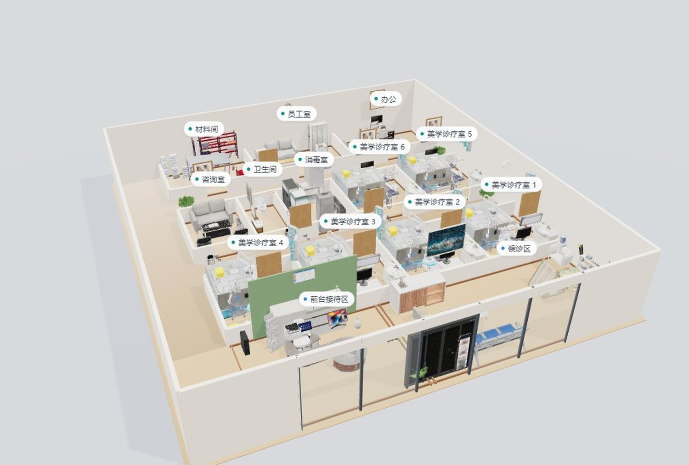

# 口腔诊所平台 · 项目报告书 / 3D 资产库 / 演示

像配车一样，配一家口腔诊所：351 件由 **Lux3D** 生成的诊所物件，被组织成一个可配置的平台——选档位、选门店类型、选风格、插模块，30 秒得到一套 3D 空间、三张 A2 图和一份带工期的造价。

群核科技 Aholo 全球 3D AI 黑客松 · 团队 **GRZ** · 2026-11-18



## 三个入口

| | 地址 |
|---|---|
| **项目报告书**（含过程截图、资产迭代对比、关键效果） | <https://gaogao94.github.io/dental-clinic-3d/> · [PDF](report.pdf) |
| **3D 资产库**（351 件目录：名称、分类、优先级、体积、缩略图） | <https://gaogao94.github.io/dental-clinic-3d/catalog/> |
| **在线演示**（平台配置器，含出图与报价） | <https://dma.automed.cn/demo/index.html> |

> 演示站由自托管服务器提供：浏览器只访问它自己的服务器，服务器用凭据从对象存储取模型并落盘缓存。**不暴露对象存储直链、没有签名 URL、不会因链接过期失效。**

## 这个仓库里有什么

- `index.html` / `report.pdf` — 项目报告书（网页版与 PDF 版）：判断、理念、生产流程、质检返工、资产迭代对比、配置器与出图效果、工程细节、边界、评审对照。
- `catalog/` — **3D 资产库的表**：351 件物件的编号、中英文名、分类、优先级、参考尺寸、交付体积、积分、taskId、缩略图；附 `inventory.json` / `catalog.csv` / `catalog.xlsx`。
- `demo/` — **配置器源码**：three.js 场景、房间与家具布局、平台/门店/风格/模块数据、CAD 出图、报价引擎、UI。与线上演示同源。
- `source/` — 生成与校验的工具链、三档样板配置的图纸与报价、生成与质检日志。
  - `source/tools/`：`generate_all.py`（滚动报价 + 5 并发 + 即下即存）、`optimize_models.mjs`、`build_demo_lod.mjs`、`dump-footprints.mjs`、`verify-drawing-quote.mjs`、`validate_dxf.py`、`shot-sheet.mjs` 等。
  - `source/samples/`：S / M / L 三档的 DXF、SVG、报价 CSV 与报价 JSON。
  - `source/logs/`：任务记录、滚动报价、预算台账、五轮质检、收尾状态（不含密钥）。

## 关键数字

| 资产 | 配置器 | 出图与报价 |
|---|---|---|
| 351 件 + 9 件补充件，13 类空间 | 3 档平台 × 5 类门店 × 5 风格 × 6 模块 | 3 张 A2 图页：平面 / 点位 / 工程量表 |
| 全部由 Lux3D image-to-3D / text-to-3D 生成 | M 档 440 种、L 档 1,050 种组合 | DXF R2007 · SVG · CSV · PDF |
| 交付 683.7 MB，演示 LOD 113.4 MB | 平台件 / 差异件描边，复用率 53% | 1,595 组组合校验，11,957,003 条断言，0 失败 |
| 351 / 351 成功，0 坏件，7 件可用边界件 | 硬点：水 / 电 / 气 / 排 / 网 | 造价含税 ±8%，工期为净施工工期 |

生成窗口：2026-11-12 02:03 → 04:39（2 小时 36 分），消耗 652 / 3,200 积分，平台 REPORT 回执 `ACCEPTED · OK`。

## 为什么模型不在仓库里

模型文件（351 件交付 GLB + 152 件演示 LOD + 9 件补充件，合计约 4.2 GB）不随开源仓库分发：Git 仓库不适合承载这个体量，且演示页也不应把对象存储地址暴露给浏览器。仓库提供的是**清单、目录、缩略图、生成脚本与日志**；3D 体验统一走 <https://dma.automed.cn/demo/index.html>。

本地运行演示需要把模型放回 `demo/lod-models/`（152 件）与 `demo/extra/models/`（9 件），然后：

```bash
node demo/serve.mjs          # 需要 Node 18+；three.js 已本地化
# 或 python -m http.server 8080（根目录）
```

## 数据与口径

- 资产为 AI 生成：形体与比例整体可用，局部细节不保证等同真实产品；清单里的尺寸是可核对的参考值，用于工程设计与施工前须按实物核对。
- 出图是**方案阶段**的平面布置图与机电点位图，可作 CAD 二次设计底图，不是结构 / 节点施工图。
- 造价是估算口径（含税、±8% 区间），工期为净施工工期，不含设备采购与报建审批。
- 报价单价与工效集中在 `demo/js/price-book.js`：改数不改公式。

## 使用说明

代码与文档用于本次黑客松的评审、复现与学习交流。3D 资产由 AI 生成，商用前请自行完成产品与规范核对。
